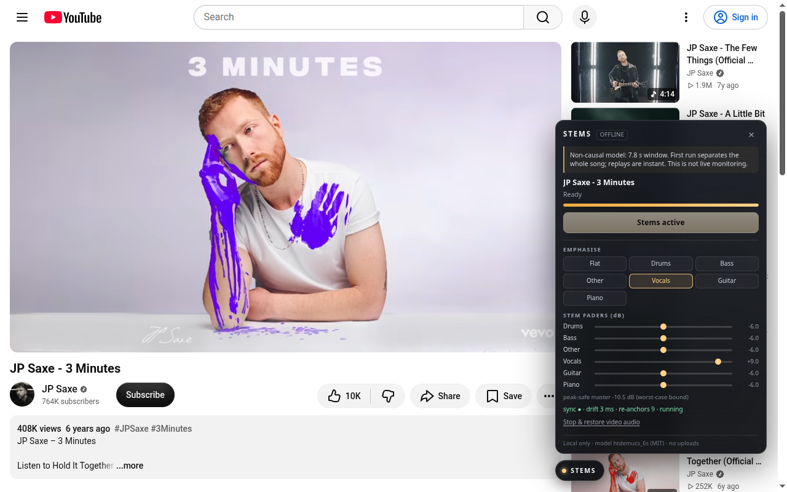

# Stems for YouTube

Local six-stem separation for YouTube watch pages. Chrome MV3 first; a Firefox manifest is included but not verified.
No server, no upload, no Spotify, no other sites.

**Just in time, not live input.** htdemucs_6s is non-causal and always consumes a fixed 7.8 s window. The extension
fetches the whole song, then separates it one 5.85 s stride at a time starting at the playhead, and plays each piece as
soon as it lands; the video keeps playing with its own audio until then. Stems start about 5 s after the click
(M1 Pro). Everything is cached in IndexedDB, so replays are instant. The sections below are the earlier,
whole-song-first measurements.

## Status

- Tested end to end on a real YouTube watch page, Chrome 154.0.8037.57, Linux x86_64, RTX 4060 Laptop, WebGPU.
- The model is the float64-to-float32 converted htdemucs_6s ONNX export (252,589,213 bytes), run with
  onnxruntime-web 1.30 WebGPU EP plus its small WASM fallback for shape ops.
- Six stems: drums, bass, other, vocals, guitar, piano.
- All measurement, verification and failure notes are in this README and in 'test/results/final.json'.

## Measured (2026-10-20)

Song: **JP Saxe - 3 Minutes**, video 'v6j8ZlhMkeU', 212.24 s (3:32) of real audio from YouTube.
Machine: RTX 4060 Laptop, Chrome 154, headful under Xvfb with Vulkan.

| metric | value |
|---|---|
| click to ready | **64.2 s** |
| audio fetch + decode + lookup | 3.9 s (watch page 1.2 s, player API, ~5.9 MB AAC, decode 44.1 kHz stereo) |
| engine start (ORT session + warm-up) | 6.0 s (session 4.3 s, warm-up 1.6 s) |
| worker total | 60.3 s for 37 windows (includes engine start) |
| per-window compute | **1.397 s mean** (min 1.388, max 1.406) |
| compute RTF | **0.179** (1.397 s per 7.8 s window) |
| end-to-end RTF | **0.284** (64.2 s per 212.2 s audio) |
| non-compute overhead in the worker | 8.6 s (overlap-add, int16 conversion, stats, IndexedDB writes) |
| cache reload to playing | **0.29 s** |
| cache size | 224.6 MB (90 records, 15 s chunks, int16 stereo) |
| Chrome process-tree RSS, after separation | **~6.45 GB** summed (page JS heap ~270 MB) |
| storage quota seen | 10.8 GB |
| master audio RMS | 0.0195 at 3.6 s, 0.050 after seek; non-zero |
| stem RMS (drums/bass/other/vocals/guitar/piano) | 0.116 / 0.112 / 0.037 / 0.128 / 0.031 / 0.066 |
| stem peak | 1.05 / 0.87 / 0.53 / 0.97 / 0.43 / 0.64 |
| off-diagonal stem correlation | min -0.046, max 0.198 |
| drift after seek (settled) | 0 ms (transient max 57 ms) |
| pause to sources | 0 |
| play again drift | 9 ms |
| 1.25x rate drift | 21 ms (pitch shifts; see limits) |
| tab switch 5 s, return | 5 ms |

A 4-minute song is a projection, not a measurement: 42 windows x 1.397 s + 6.0 s engine + 9.7 s overlap-add + 3.9 s
fetch is roughly **78 s**. The brief's 45-60 s estimate is not met on this box: GPU compute alone is 58.7 s for four
minutes.

## Install (development)

1. Chrome 113+ with working WebGPU ('chrome://gpu' should show WebGPU: Hardware accelerated).
2. Open 'chrome://extensions', enable Developer mode, choose **Load unpacked**, select this folder.
3. Open a YouTube watch page. A small **STEMS** pill appears at the bottom right. Click it.
4. Press **Separate this song**. The video pauses and is muted while the whole song is processed; it resumes when
   ready. Later visits show **Load cached stems** and start in well under a second.
5. Choose an instrument to emphasise (+9 dB featured, -6 dB others, exactly like the existing mixer pages), or move
   the per-stem faders. **Stop and restore video audio** puts the original audio back.

The unpacked folder is ~327 MB: model 241 MiB, onnxruntime-web vendor bundle 84 MB, code/tests the rest. This is a
development payload; see **Distribution** below.

## How it works

    content script (isolated world)
      |  panel UI, video mute/play/pause/currentTime, Web Audio graph
      |  6 gain nodes -> peak-safe master -> analyser -> destination
      |
      +-- postMessage --> extension-origin iframe (src/host.html)
                            |  fetch watch page + YouTube player JSON (VisionOS client),
                            |  fetch audio (Range), decode to 44.1 kHz stereo,
                            |  owns extension-origin IndexedDB
                            |
                            +-- module worker (src/engine.worker.js)
                                   onnxruntime-web WebGPU, 7.8 s windows, 25% overlap,
                                   int16 chunk writes + RMS/peak/correlation stats

Why the iframe: a content script cannot construct a chrome-extension worker (the page CSP blocks it), and MV3
content-script fetch is page-CORS bound. The iframe has the extension origin, host permissions and its own CSP, so
it can fetch YouTube/googlevideo and spawn the worker. It renders nothing.

Audio acquisition: YouTube's WEB player now uses SABR (POST, protobuf) and the page's adaptiveFormats contain no
direct URLs. The host asks the internal player endpoint with the **VISIONOS** client (as yt-dlp does), plus the
visitorData from the watch page, and gets ordinary audio URLs (251 Opus first, 140 AAC fallback), downloads the whole
file with 'Range: bytes=0-', and decodes it. No cookies are sent (credentials: omit).

Separation: exactly the published infer.py windowing: window length 343,980 samples, overlap 85,995 (25%), stride
257,985, linear fades, overlap-add divided by accumulated weight. The ONNX output is [1,6,2,343980]. A float64 to
float32 rewrite of the stock export is required for ORT-web; the shipped model is that converted file (produced by
engine/webgpu-spike/make_web_model.py, not modified here). Parity vs the original is 5.96e-08.

Cache: extension-origin IndexedDB, database 'stems-yt-cache', keyed by video id. Fifteen-second chunks per stem
(6 stems x N chunk records), int16 interleaved stereo with a fixed 4x headroom (storeScale: 4). Metadata is written
only after every chunk; a partial cache is ignored and re-separated. Chunk records are read on demand for playback,
so the page never holds the full song as PCM.

Playback: 15 s slices are queued 18 s ahead, six AudioBufferSourceNodes per slice into the six gain nodes. The
AudioContext is created on the Start click (user gesture) at 44.1 kHz. The anchor maps media time to AudioContext
time; a 90 ms watchdog re-anchors on seek/pause/play/rate/ad, and a second settle re-anchor 0.9 s later removes the
start offset. Buffering pauses the stems instead of chasing the stalled video clock.

Mixer and peak safety: gains are exact +9 dB for the emphasised stem and -6 dB for the others; faders are absolute dB.
The master gain is 0.891 / B where B is the maximum over 250 ms blocks of the sum of abs(gain_i) * stemPeak_i(block).
That is a strict upper bound on the mixed peak, so the output never exceeds -1 dBFS, even when stems sum in phase.
It is conservative, so the mix can be quieter than YouTube; the panel shows the applied master trim. Flat playback
uses the same 250 ms envelope (present in the cache metadata from this build onward; older caches fall back to a
whole-song bound and are quieter).

## Honest limits and what breaks

**For a normal user on a laptop with integrated graphics**

- Memory is the wall. The fp32 model plus ORT's graph copy plus WebGPU driver allocations put the Chrome process tree
  at **~6.45 GB summed RSS** on a 3:32 song. An 8 GB laptop with an iGPU will be swapping or OOM; 4 GB will fail.
  A 16 GB Apple Silicon or dGPU laptop is the realistic minimum. The model's own ~5 GB is measured with the RTF
  spike on the same box; this build adds the song buffers and the page.
- WebGPU must exist and be a real adapter. With no navigator.gpu or a null/fallback adapter the extension says so
  and disables Start. It does **not** fall back to WASM: the 258 MB fp32 model measured std::bad_alloc under
  wasm32. Headless Chrome has no usable WebGPU here either; WebGPU works headful under Xvfb with Vulkan flags.
- First run is 64 s for 3:32 and ~78 s for 4:00 [projection], not the 45-60 s from the brief. The GPU compute itself
  is 1.40 s per 7.8 s window; the rest is model start-up, overlap-add/stats, and fetch/decode. Cached replays are 0.3 s.
- Disk grows by ~1.06 MB per second of music (~254 MB for a 4-minute song). Chrome's observed quota was 10.8 GB,
  i.e. roughly 40 four-minute songs before eviction.
- Rate changes are sync-correct but pitch-shift the stems (AudioBufferSourceNode.playbackRate), while YouTube keeps
  pitch. Drift is corrected; pitch is not. This is a known limitation, not an advertising claim.

**YouTube coupling**

- Direct audio URLs come from an unofficial internal player client (VISIONOS, client id 101, hard-coded version/API
  key in src/host.js). If YouTube removes that client, requires a PO token, or serves SABR-only, separation fails
  with a visible error. It is the one network-fragile part of the design.
- No DRM (Spotify, YouTube Music premium-only streams), no age-restricted/members-only videos, no live streams.
- If the fetched audio and the video timeline disagree by a constant container offset, the extension does not measure
  that offset; it anchors on currentTime. Drift is controlled; absolute millisecond alignment is not verified with a
  reference signal.
- Ads: pressing Start during an ad is allowed (the audio fetch does not need the video element); stems wait for the
  ad and join when it ends. The ad path was tested by toggling the player's ad-showing class.

**Separation quality**

- Six stems is the model ceiling. Other is a bucket (strings, synths, organ). Bleed and hollow transients are normal.
- The model is 7.8 s non-causal: it cannot be used for live monitoring, mic input, DJ effects, or streaming. The UI
  states this at the top of the panel; this README repeats it on purpose.
- The int16 cache has 4x headroom, so its quantisation noise floor is about -78 dBFS. A stem peaking above 4.0 would
  clip in the cache; this was not observed (max peak 1.05 over the test song).

**Chrome and Firefox mechanics**

- Chrome 154 ignores the old --load-extension command-line switch. Users must use **Load unpacked** in
  chrome://extensions; the automated test loads through the DevTools Extensions.loadUnpacked CDP command.
- Firefox: manifest.firefox.json is included, with browser_specific_settings, the same content script/iframe and
  CSP. It is **not verified**. Firefox's WebGPU availability varies by platform/version; the UI will stop with a clear
  message if it is absent.
- The extension requests only host access to youtube.com and googlevideo.com. It does not request storage, tabs,
  scripting, or offscreen. All state not in IndexedDB lives in the content-script memory.

## Distribution of the 241 MB payload

The converted fp32 model is 252,589,213 bytes. Shipping it inside the extension is fine for development and unpacked
loading, but distribution still needs a decision:

- A 241 MiB extension update is unpleasant; the Chrome Web Store limits and review time are the practical issues.
- The published fp16-weight variant is 136 MB (htdemucs_6s_fp16weights.onnx). It still needs the float64 to float32
  conversion check and a WebGPU accuracy/latency pass; not tested here.
- Hosting the model separately (for example Cache Storage with a versioned URL and integrity hash) makes the
  extension small but adds a server/CDN dependency, which conflicts with the no-server design unless it is a
  one-time static asset.
- No decision is made here; the current build is a local dev payload and says so.

## Reproduce

The automated tests are under test/. They drive a real YouTube page in Chrome under Xvfb, click the actual injected
panel, and read a diagnostics element the content script keeps updated.

    # one Chrome at a time; profile under ~/.cache
    xvfb-run -a python3 test/e2e_final.py v6j8ZlhMkeU fresh

This performs a fresh separation, checks playback/RMS, seeks, pauses/resumes, emphasises vocals, reloads the page
and verifies the cache hit. It writes test/results/final.json and the screenshots in shots/.

Other checks:

    xvfb-run -a python3 test/sync_probe.py         # seek + pause/resume, re-anchor log
    xvfb-run -a python3 test/rate_tab_probe.py     # 1.25x, synthetic ad class, tab switch
    xvfb-run -a python3 test/ad_rate_probe.py      # Start during an ad, rate settle
    xvfb-run -a python3 test/nogpu.py              # headless/no-adapter failure path (screenshot)
    xvfb-run -a python3 test/spa.py                # YouTube home -> watch SPA navigation

Chrome flags used for WebGPU on this Linux box (headful; headless has no adapter here):

    --enable-unsafe-webgpu --ignore-gpu-blocklist --enable-features=Vulkan
    --use-vulkan=native --disable-vulkan-surface

These flags are for the test rig, not a requirement for end users with a supported GPU. Chrome's normal WebGPU
enablement is enough when chrome://gpu reports hardware acceleration.

## Files

    manifest.json                 Chrome MV3 manifest
    manifest.firefox.json         Firefox MV3 manifest (unverified)
    src/content.js                UI, video control, Web Audio playback and sync
    src/ui.css                    scoped panel styles
    src/host.html / src/host.js   extension-origin iframe: fetch, decode, IndexedDB, worker host
    src/engine.worker.js          ORT WebGPU worker, overlap-add, cache writes, stats
    vendor/                       onnxruntime-web 1.30 local bundle (jsep wasm)
    models/htdemucs_6s_web.onnx   converted float32 htdemucs_6s export
    test/                         Playwright probes, E2E driver and results
    shots/                        verification screenshots

## Credits

- Music source separation: **htdemucs / Demucs**, Meta Research, MIT.
- ONNX export: **StemSplitio/htdemucs-6s-onnx** on Hugging Face, MIT; model card and infer.py are the reference for
  the windowing used here.
- ONNX Runtime Web 1.30, Apache-2.0, vendored locally.
- The float64 to float32 conversion script lives in engine/webgpu-spike/make_web_model.py and is not modified by this
  extension; the converted model is copied from that spike.